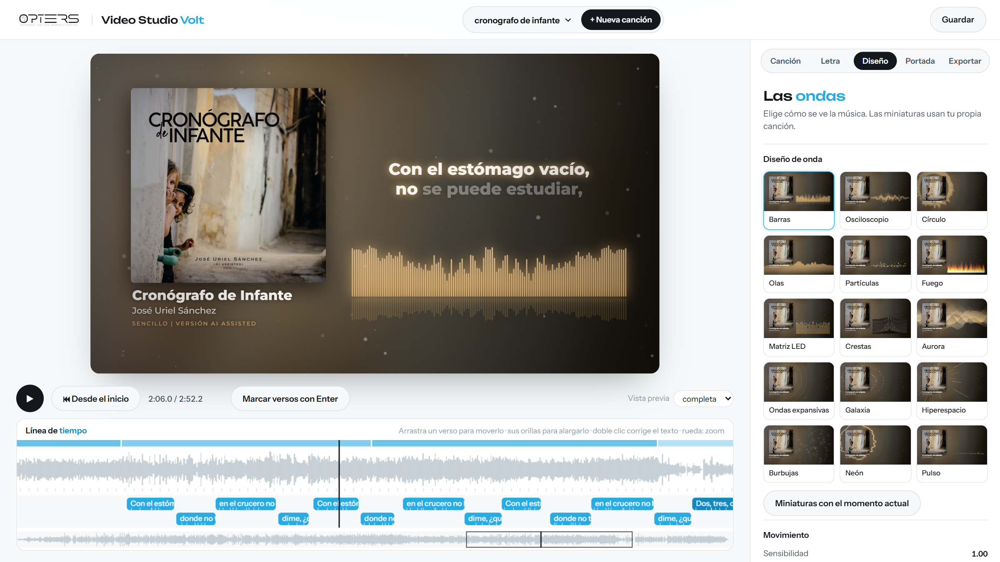
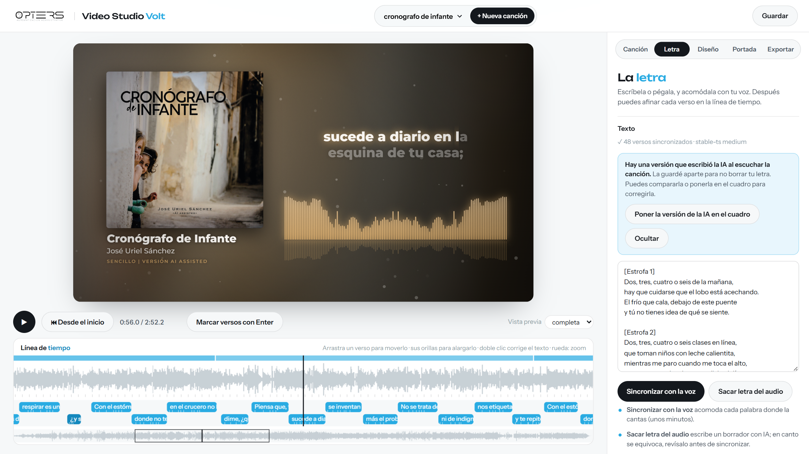
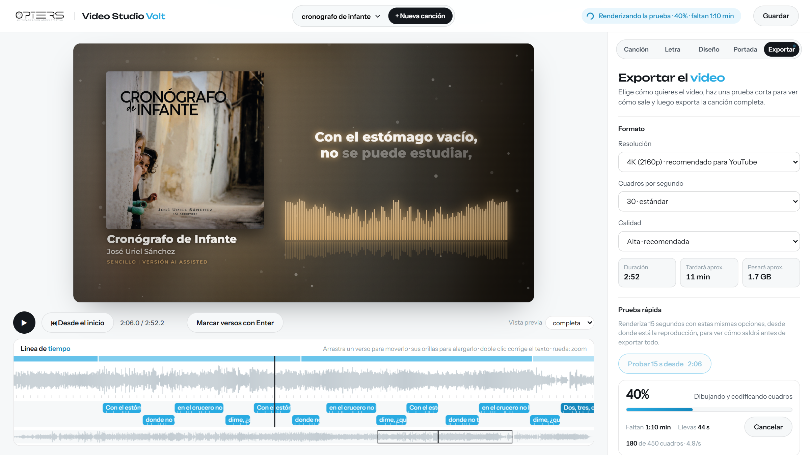
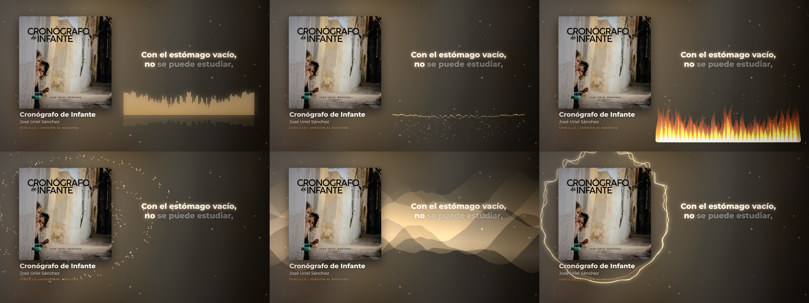
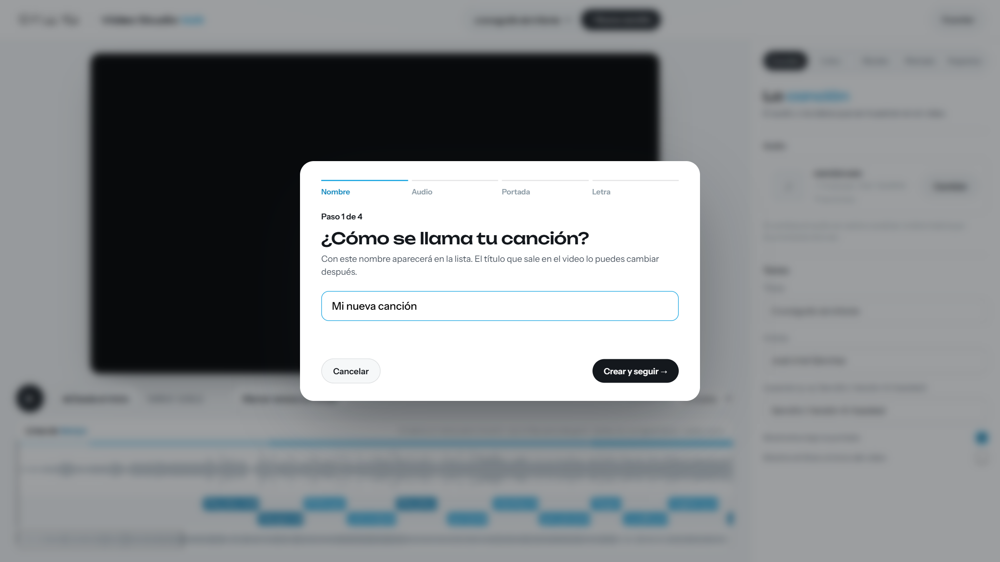

# Video Studio Volt

Un desarrollo de **Opters**.

Convierte tu canción en un video para cualquier plataforma de video: ondas que siguen la música, la letra apareciendo
justo cuando la cantas y la portada con estilo. Lo editas en el navegador, lo ves al
momento y lo exportas en 4K.



## Lo que hace

- **15 diseños de onda**: barras, osciloscopio, círculo, olas, partículas, fuego, matriz LED,
  crestas, aurora, ondas expansivas, galaxia, hiperespacio, burbujas, neón y pulso. Todos se
  mueven con el ritmo, los graves y la voz de tu canción.
- **Letra sincronizada sola**: pegas tu letra y la IA la acomoda palabra por palabra con tu voz.
  Si no la tienes escrita, la saca del audio como borrador.
- **Línea de tiempo** para afinar cada verso: arrastrar, alargar, corregir el texto o marcar los
  versos con Enter mientras suena.
- **Portada estilo Spotify**: tu imagen a un lado y, de fondo, ella misma desenfocada con sus colores.
- **Título, artista y leyenda** (p. ej. «Sencillo | Versión AI Assisted»).
- **Exportar** en 4K, 2K o Full HD, a 24, 30 o 60 cuadros por segundo, con prueba rápida de
  15 segundos, barra de avance y tiempo restante.
- Todo corre en tu computadora: nada se sube a internet.

| Letra | Exportar |
|---|---|
|  |  |



## Instalar

### La forma fácil: con Claude

Si usas [Claude Code](https://claude.com/claude-code) (app de escritorio o terminal), dile:

> Instala esta herramienta: https://github.com/urielovolt/video-studio-volt

Claude la descarga, instala todo lo necesario y la abre. Las instrucciones que sigue están en
[`CLAUDE.md`](CLAUDE.md).

### A mano (Windows 10/11)

1. Descarga el proyecto (botón verde **Code → Download ZIP**) y descomprímelo, o
   `git clone https://github.com/urielovolt/video-studio-volt.git`.
2. Doble clic en **`Instalar.bat`**. Instala Python 3.13 si falta y todo lo demás en una carpeta
   `.venv` dentro del proyecto. Tarda de 5 a 15 minutos (PyTorch es la descarga grande).
3. Doble clic en **`Iniciar.bat`**. Se abre la app en el navegador. Deja esa ventana abierta
   mientras la usas.

Requisitos: Windows 10/11, ~6 GB libres, Microsoft Edge (viene con Windows). Una tarjeta de video
ayuda mucho al exportar, pero no es obligatoria.

## Cómo se usa

1. **+ Nueva canción**: un asistente de 4 pasos (nombre, audio, portada, letra).
2. **Letra**: pega tu letra y «Sincronizar con la voz». Arriba ves qué está haciendo y cuánto lleva.
3. **Diseño**: elige la onda, los colores (o los de tu portada) y el ambiente.
4. **Exportar**: «Probar 15 s» para ver cómo sale y luego «Exportar video». Al terminar te dice
   dónde quedó el archivo.

Atajos: Espacio reproduce, Inicio vuelve al principio, ←/→ saltan 2 s, Ctrl+S guarda, Ctrl+Z deshace.



## Cómo funciona

- `herramienta/analizar.py` mide la canción una sola vez (librosa): espectro, ritmo, golpes,
  secciones y la energía de la voz, a 60 cuadros por segundo.
- `herramienta/sincronizar.py` separa la voz con **Demucs** y alinea (o transcribe) la letra con
  **Whisper** a través de **stable-ts**.
- `herramienta/motor.js` y `disenos.js` dibujan cada cuadro en un `<canvas>` a partir de esos
  datos. Cada cuadro depende solo del tiempo, así que la vista previa y el video salen idénticos.
- `herramienta/render.py` abre la página en Edge con **Playwright**, dibuja cuadro por cuadro con
  la GPU y codifica H.264 con WebCodecs; luego une el audio original en AAC 320 kbps con ffmpeg.
- `herramienta/servir.py` es el servidor local que une todo con el editor (`video.html`).

Las canciones quedan en `canciones/<nombre>/` (audio, portada, letra, estilo y videos) y no se
suben a git.

### Por consola

```
.venv\Scripts\python herramienta\analizar.py canciones\mi-cancion
.venv\Scripts\python herramienta\sincronizar.py canciones\mi-cancion
.venv\Scripts\python herramienta\render.py canciones\mi-cancion --desde 60 --hasta 75
.venv\Scripts\python herramienta\render.py canciones\mi-cancion --resolucion 2160 --fps 30
```

### Consejos de calidad

- Deja el **grano de película** entre 0.1 y 0.2: es ruido distinto en cada cuadro y el codificador
  (y luego YouTube) gasta bits en él en vez de en la imagen.
- 4K se ve mejor en YouTube aunque la gente lo vea en 1080p: YouTube le da más calidad.

## Notas de Windows

El Control de aplicaciones de Windows puede bloquear DLL que no reconoce. Las versiones de
`requirements.txt` son las que sí pasan (Python 3.13, torch 2.6.0, numba 0.65); no las actualices
sin probar. Si la ruta de tu usuario tiene acentos, el detector de voz de Silero no funciona y
por eso la alineación va sin él.

## Créditos

Hecho con [Whisper](https://github.com/openai/whisper), [stable-ts](https://github.com/jianfch/stable-ts),
[Demucs](https://github.com/facebookresearch/demucs), [librosa](https://librosa.org),
[Playwright](https://playwright.dev) y [FFmpeg](https://ffmpeg.org).

## Licencia

[MIT](LICENSE) © 2026 Opters. Puedes usar, modificar y compartir el código libremente,
siempre que conserves el aviso de copyright y la licencia. El nombre y el logo de Opters son
de Opters.
